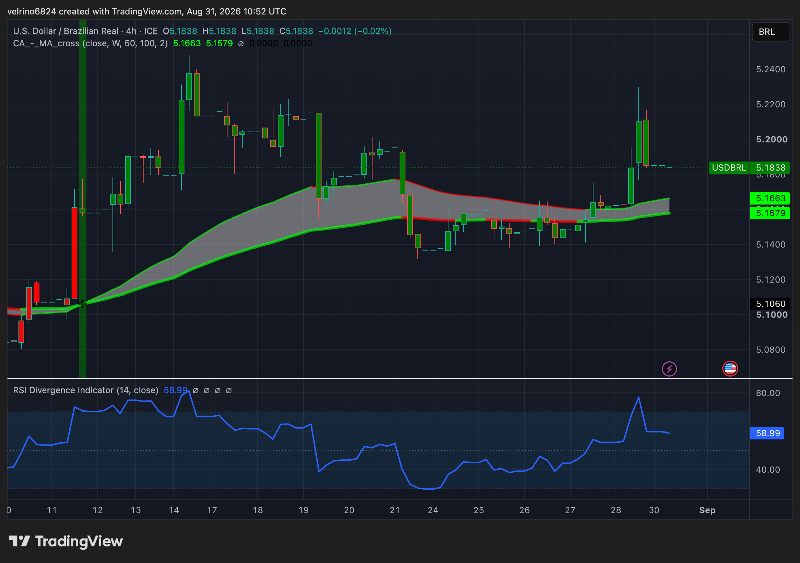

# Finance Data

This repository currently stores a USD/BRL historical analysis snapshot at:

```text
symbol/usd-brl.json
```

## USD/BRL Dataset

The `symbol/usd-brl.json` file contains daily USD/BRL candles for `FX_IDC:USDBRL`.
It was generated on `2026-08-31T10:26:50Z` from TradingView's chart websocket.

The snapshot includes:

- `5000` daily candles
- Date range from `2007-06-27` to `2026-08-31`
- Daily `open`, `high`, `low`, `close`, and `volume`
- Computed weekday fields such as `weekday` and `isMonday`
- Computed return fields:
  - `closeToCloseChangePct`
  - `openToCloseChangePct`
  - `gapFromPreviousClosePct`
  - `rangePct`
- Aggregated weekday statistics in `weekdayStats`
- A focused Monday analysis summary in `mondayPattern`
- The last 12 Monday records in `mondayPattern.last12Mondays`

## Monday Pattern Summary

The Monday pattern is measured in two ways:

- `closeToCloseChangePct`: Monday close compared with the previous trading day's close.
- `openToCloseChangePct`: Monday close compared with Monday open.

Current Monday summary:

```json
{
  "mondayBars": 1001,
  "averageCloseToCloseChangePct": 0.098448,
  "medianCloseToCloseChangePct": 0.036303,
  "positiveRate": 0.5225
}
```

## Today's Bias — August 31, 2026

**Combined conclusion:** today's directional outlook is **mixed and low-confidence**. The Monday pattern provides a slight bearish intraday tilt, while the 4-hour indicators provide bullish trend support. If one label is required for today's close, the bias is neutral with a slight bearish tilt; the broader 4-hour structure remains bullish while price holds above the `5.1663–5.1579` moving-average band.

The comparison below uses the previous `1000` completed Mondays and excludes today's partial candle. In this snapshot, USD/BRL was trading at `5.1838`, down `0.0231%` from the previous close of `5.1850`.

| Evidence | Historical result or today's reading | Signal | Interpretation |
|---|---:|:---:|---|
| All completed Mondays | Up in `52.30%`, down in `45.90%`; mean return of `+0.0986%` and median return of `+0.0365%` | Slightly bullish | There is a small historical advantage for an upward move, but `52.30%` is close to a random outcome. |
| Monday after a positive previous session | `496` cases; up in `49.40%`, down in `49.60%`; median return of `0.0000%` | Neutral | Friday's `+0.4436%` gain does not, by itself, create reliable continuation on Monday. |
| Monday with no opening gap | `570` cases; up in `48.25%`, down in `49.47%`; median return of `0.0000%` | Neutral/slightly bearish | Today's opening gap was `0.0000%`. Opening without a gap is common (`57.00%` of Mondays) and does not provide a strong directional signal. |
| Monday with no gap after a positive session — the closest match to today | `283` cases; up in `47.00%`, down in `51.94%`; mean return of `+0.0335%` and median return of `-0.0592%` | Slightly bearish | Both the majority of outcomes and the median favor a decline, but the difference is small and the mean remains positive because of larger upward moves. |
| Today's move versus the previous close | `-0.0231%`, at the `44.7th` percentile of historical Mondays | Slightly bearish | Trading below both the opening price and the previous close favors a decline at this point, but the move is normal and very small. |
| Today's candle range | `0.0231%`, versus a historical median of `1.1461%`; `0.9th` percentile | Inconclusive | This is the main difference from the historical pattern and is explained by the candle still being in progress. It should not be interpreted as low volatility for the entire day. |

### Is Today's Behavior Different?

In terms of direction, **no**: today's small decline is near the center of the historical distribution and is not unusual. The absence of an opening gap also matches the most common Monday behavior. The only meaningful difference is the extremely narrow range, but this is primarily due to the snapshot time and may disappear as the session progresses.

## 4-Hour Indicator Context



The chart was captured on August 31, 2026 at `10:52 UTC`. It uses the legacy [`CA_MA` Pine Script](script/ca-ma.pine) on the price panel and an RSI Divergence Indicator with a `14`-period RSI based on `close`.

| Indicator evidence | Reading | Signal | Interpretation |
|---|---:|:---:|---|
| USD/BRL price | `5.1838` | Bullish versus the MA band | Price is `0.3387%` above the short average and `0.5021%` above the long average. |
| CA_MA short average | `5.1663` | Bullish | The short average is rising and is `0.1629%` above the long average. |
| CA_MA long average | `5.1579` | Bullish | The long average is also rising, so both components of the band support the upward structure. |
| RSI `(14, close)` | `58.99` | Neutral/bullish | RSI is above the neutral `50` level and below the conventional `70` overbought level. Momentum remains positive without being overbought. |
| Recent RSI behavior | Fell from above `70` to `58.99` | Caution | Momentum cooled after the latest price surge. This weakens the immediate upside case without reversing the broader positive reading. |
| Recent 4-hour price action | Rejected near `5.23` and returned to `5.1838` | Short-term bearish | The rejection shows nearby selling pressure even though price remains above the moving-average band. |

### Combined Pattern Assessment

The historical and chart-based signals point in different directions:

- The closest Monday pattern — no opening gap after a positive previous session — closed lower in `51.94%` of cases and higher in `47.00%`, which is only a weak bearish edge.
- The CA_MA overlay remains bullish because price is above both averages, the short average is above the long average, and both are rising.
- RSI at `58.99` confirms positive momentum, but its decline from above `70` and the rejection near `5.23` show that the latest bullish impulse is losing strength.

The best synthesis is therefore **bullish trend structure with a neutral to slightly bearish short-term pullback**. A move below the `5.1663–5.1579` band would weaken the bullish structure shown in this snapshot; remaining above it preserves that structure.

### CA_MA Implementation Note

The script uses legacy Pine Script syntax and is configured in the screenshot with `close`, timeframe `W`, periods `50` and `100`, and calculation mode `2`, which the source maps to EMA.

There is an important multi-timeframe limitation in the current implementation. It first requests the higher-timeframe price with `security(tickerid, res, pricetype)` and then calculates the moving averages from that mapped series. On a 4-hour chart, this is not equivalent to calculating the 50- and 100-period EMAs inside the weekly context. The displayed values should therefore be treated as this script's MTF moving-average band, not automatically as verified 50-week and 100-week EMAs. A modern implementation should calculate each average inside `request.security()`, explicitly choose whether to use live or confirmed higher-timeframe values, and document the repainting behavior. See [TradingView's higher-timeframe data documentation](https://www.tradingview.com/pine-script-docs/concepts/other-timeframes-and-data/).

Despite the word “Alert” in the indicator's name, the source only draws background changes and Buy/Sell shapes. It does not define `alertcondition()` rules for native TradingView alerts.

This outlook is exclusively statistical and technical and is based on the local dataset. It does not incorporate news, interest rates, currency flows, or the day's macroeconomic events, and it is not financial advice.

## Source Note

TradingView loads candle history through an internal, undocumented chart feed.
This dataset should be treated as an analysis snapshot, not as a stable production API integration.
